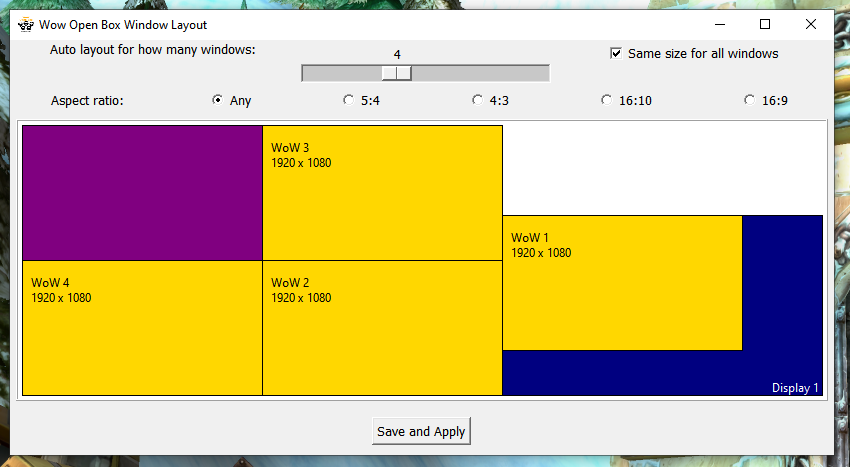
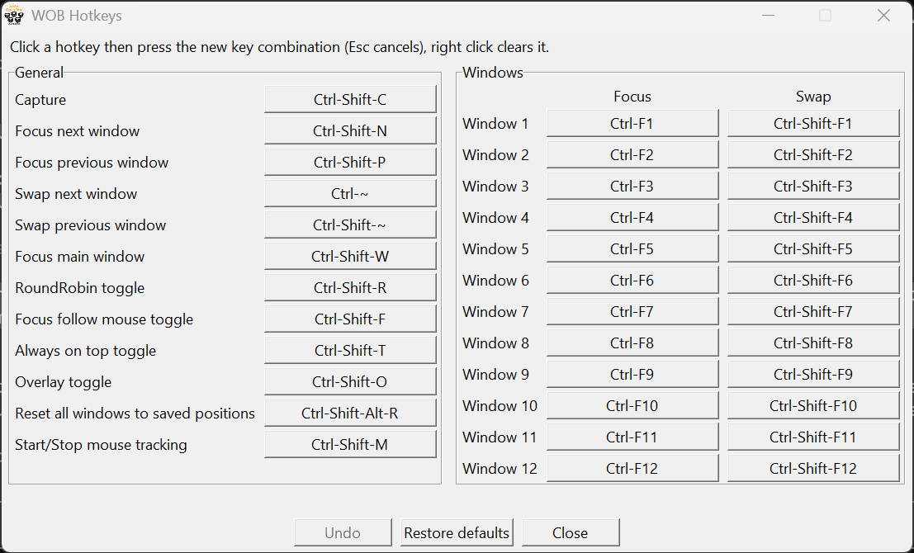
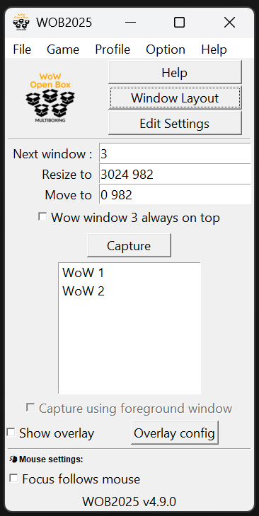
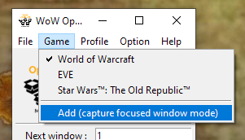
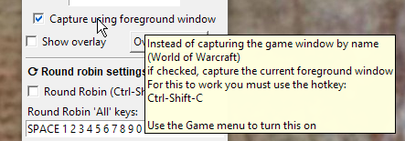

# Wow Open Box online HELP

## Basic information

1. Use the "Window Layout" UI to setup your Windows automatically. And you can tweak the intelligent auto layouts by:
    + Dragging any window to reposition it
    + Resize it by dragging the orange bottom right corner
    + Toggle "Stay on top" by clicking on the text
    + Use the snap to grid feature to constraint the position
    + Use the arrow keys for precise movement by 1 pixel

1. _and/or tweak it using:_ Manual Setup (from main window):

    1. Manually select the Size you want your next window to be(*)

    1. Manually select the position you want it to be at(*)

    1. Decide if that window should stay on top of others. you can use a hotkey (default `Ctrl-Shift-T`) to toggle that setting on the fly.(*)

1. Use the Bnet launcher to start your wow windows so you don't need to type your password, WOB/OMB will make them borderless automatically for you, but check in game resolution options to avoid pixelization (100% Render Scale, Correct window size).

1. Wob since version 4.1 will automatically capture and place the windows in their respective position for you (you can turn that option off in the Option menu). Since v4.11.0 it fills the lowest free window number first: a game restarted after its window was closed (shown as "lost") gets its number back, and a window you "Forget" (right click in the list) moves to a lower free number if there is one, otherwise it stays out of WOB. Otherwise, press the "Capture" button or use its hotkey (default `Ctrl-Shift-C`). If you want to manage other games than World of Warcraft, see the ['Other Games' section below](#other-games)

1. Press a hotkey to change which window gets the keyboard input: default key are `Ctrl-F1` for Wow 1, `Ctrl-F2` for Wow 2, etc.. or rotate between windows with hotkeys to focus the next window (defaults to `Ctrl-Shift-N`) and previous window (defaults to `Ctrl-Shift-P`). Hotkeys can be changed in File > "Hotkeys..." (see [below](#hotkeys)).

1. Press a hotkey to bring window N to the main (1) window: default `Ctrl-Shift-F2` will swap 1 and 2,  `Ctrl-Shift-F3` for swapping 1 and 3, etc... Or rotate the swap between all windows by repeatedly pressing `Ctrl-~` for forward swap or `Ctrl-Shift-~` for backward swap.

1. You can toggle the overlay on/off at any time using the default hotkey `Ctrl-Shift-O` or the checkbox on the main window.

1. You can use the FocusMain hotkey (`Ctrl-Shift-W`) to always get focus back to the physical main window location (even if it's, say, Wow3 in it).

1. **Profiles**: save different setups, for instance one per window layout (a big main window with smaller ones vs. a full screen main window), with File > "New Profile...", then change the Window Layout and "Save and Apply". Switch between them in the Profile menu or cycle through them with `Ctrl-Shift-L` (next) and `Ctrl-Shift-Alt-L` (previous). Profile > "Profiles in rotation..." picks which profiles are cycled through (all but Default by default).

*: You can change all settings at any time and they will be saved, per window index when you click "Update" or "Save and Apply" in the Window Layout GUI.

### Hotkeys

File > "Hotkeys..." shows all the hotkeys. Click one and press the new key combination (`Esc` cancels), right click clears it. A key combination already used by another hotkey is cleared from that one. Changes apply and are saved right away; Undo (or `Ctrl-Z`) goes back, up to how the hotkeys were when the window opened. If another application already uses some hotkeys, WOB opens that window with them in red so you can pick different ones.

### Mirrors

Since v4.11.0 (needs the v4.11.0 or newer `.exe`, an older one running an updated WOB shows a message with a link to download it), mirrors are live copies of an area of a game window, shown anywhere on screen at any zoom: e.g. a bigger minimap, a target frame or the portraits of the small windows next to the main one. They are drawn by Windows (no slowdown) and stay live even when the window they copy is covered by another one.

- File > "Mirrors..." opens the Mirrors window. While it is open you are in **edit mode**: mirrors have a colored border and can be changed.
- "Add a mirror": click the game window to copy from (in a stacked layout, bring the one you want to the front first), then drag a rectangle around the area. The new mirror shows next to it at its actual size (1:1).
- In edit mode:
   - Drag a mirror to move it.
   - Drag one of its sides or corners to extend or shrink the copied area (the zoom stays the same).
   - Mouse wheel to zoom in/out, by steps (1/3, 1/2, 1, 1.5, 2, 3...).
   - Right click for: "Select area again...", the Zoom submenu (shows the current zoom), "Stay on top", the source window, "Delete" and "Done editing".
- A mirror shows the window it was taken from, wherever that window currently is in the layout (when that window goes back to a small position, the mirror shows the same area of it, just less sharp). Pick "Source: main window" in its right click menu to have it show whichever window is in the main position instead. The zoom shown in the menu is relative to the source window at its current size.
- Outside of edit mode, mirrors let mouse clicks go to the window under them and never take the keyboard focus.
- "Show mirrors" in the Mirrors window shows/hides them all. There are also "Show/hide mirrors" and "Mirrors edit mode toggle" hotkeys, unset by default (set them in File > "Hotkeys...").
- Mirrors are saved with the profile.

### Mirrored layout

Since v4.11.0 (also needs the v4.11.0 or newer `.exe`), check "Mirrored" in the Window Layout window, then "Save and Apply": all the game windows are stacked at the main position, under the main window, and the other positions of the layout show live mirrors of them instead of the actual windows.

- Swaps are instant: windows are never resized, the new main window just comes on top.
- Click a mirror to make that window the main one; the mouse moves to the same spot in it.
- If a position's aspect ratio differs from the main window's, its mirror keeps the proportions with black bars (use the "Same" or a fixed aspect ratio to avoid them).
- Stay on top applies to the mirrors (the stacked windows never cover the main one).
- Focus follows mouse only applies to the main window. When you need the actual windows (e.g. to click directly in a small one), keep another profile with the same layout but not mirrored and switch to it with the profile hotkeys.
- When you exit WOB, the mirrors go away so the windows stacked under main are put back in their (small) layout positions; the setting stays on and they get stacked again the next time WOB starts.
- The setting is saved with the profile.

### Settings

Your settings are saved in `wowopenboxSettings.tcl` in same folder as WowOpenBox and can be edited pressing the "Edit Settings" button.

Make sure to also explore the File, Option etc menus (menu bar is at the top of the window) and read mouse over tooltips present in most UI elements of WOB/OMB.

## Mouse control

The "Focus follows mouse" checkbox turns on the Windows "Activate on hover" accessibility feature (Settings > Accessibility > Mouse) and sets its delay to instant (0 ms, while the Windows slider's minimum of 1 is 100 ms and its default of 5 is 500 ms). You can change that delay with `mouseDelay` (in ms) in your settings (see above). On exit, the previous Windows delay is restored and the feature turned off (unless you uncheck "Turn off focus follow mouse on exit" in the Option menu).

Whether hovering also brings the window to the front is the "Mouse auto foreground window" option in the Option menu (same as Windows' "Move window to top when activating for mouse hover").

There is a "Track Mouse" (and stop tracking) button (and hotkey, default `Ctrl-Shift-M`) to track coordinates to help doing pixel perfect placement of your windows

You can toggle the focus follow mouse behavior using a hotkey (default `Ctrl-Shift-F`)

## Other Games

Use the Game menu to select your Game and/or check the Capture using foreground window:

Read the help text mouse over tooltip:

You must click your game window and use the capture hotkey (`Ctrl-Shift-C` by default, changeable in settings) to use that mode; after which your game name should be recorded in the Game menu and you can stick to normal Auto Capture (Options Menu).

## Need more help? Report a problem? Suggest a new feature?

Make sure you are running the latest [release](https://github.com/WowOpenBox/WowOpenBox/releases)

In rare case if things seems wrong, you can try to either restart WOB/OMB, it will resume where you left off so no need to touch your game windows when or if you do. Or you can use the Reset-All hotkey (default binding is `Ctrl-Shift-Alt-R`) which should put all windows in their home position. But if this persists please file a bug and explain in details how to reproduce the problem with minimal steps:

Check if your [issue](https://github.com/WowOpenBox/WowOpenBox/issues/) or suggestion has already been report and if not make a new detailed one

Check the [FAQ](https://github.com/WowOpenBox/WowOpenBox/wiki/FAQ)

Reach out on 

If your game or application allows Broadcasting, switch over to [OMB (OpenMultiboxing)](https://openmultiboxing.org).
